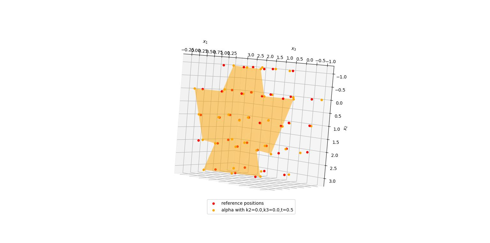

# Cross-section warping in atomic rods

Numerical approximation of the **relaxed quadratic form** in the model for **ultrathin 
elastic rods** from [1] (see equation (3.3)), which is inspired by nanowires.
$$
Q_{\rm cell}^{\rm rel}(A):=\min_{\substack{\alpha\colon\mathcal{L}^{\rm ext}\rightarrow\R^3\\ g\in\mathbb{R}^3}}\sum_{x'\in\mathcal{L}'^{,\rm ext}} Q_{\rm tot}\biggl(x',\frac{1}{2}
\bigl(A(0,x')^T+g\bigr)(-1,-1,-1,-1,1,1,1,1)\\
+\frac{1}{4}A{\scriptstyle\begin{pmatrix}
\scriptstyle 0&
\scriptstyle 0&
\scriptstyle 0&
\scriptstyle 0&
\scriptstyle 0&
\scriptstyle 0&
\scriptstyle 0&
\scriptstyle 0\\
\scriptstyle 1&
\scriptstyle 1&
\scriptstyle -1&
\scriptstyle -1&
\scriptstyle -1&
\scriptstyle -1&
\scriptstyle 1&
\scriptstyle 1\\
\scriptstyle 1&
\scriptstyle -1&
\scriptstyle -1&
\scriptstyle 1&
\scriptstyle -1&
\scriptstyle 1&
\scriptstyle 1&
\scriptstyle -1
\end{pmatrix}}
+\bigr(\bar{\nabla}^{2\rm d}\alpha|\bar{\nabla}^{2\rm d}\alpha\bigr)\biggr)
$$
(You can read the definitions of the variables in the source article.)

The implementation in its current version is only illustrative and not optimized 
for best performance on medium or large cross sections of the rod.

The **cell energy** function originates from a mass-spring model with 
nearest-neighbour and next-to-nearest-neighbour interactions on a cubic lattice 
(see [1, Example 2.1]).

To obtain the value of the relaxed quadratic form at a given 
skew-symmetric matrix $A$, minimization over variables $\alpha$ and $g$ is performed. 
$\alpha$ is related to **warping** of the rod's cross section in torsion and **lateral contraction** due to bending, whereas $g$ is a **stretch** vector, uniform
in the cross-sectional plane.

The minimizer is visualized using 3D plotting in Matplotlib.

For higher physical relevance, surface terms would also have to be added 
to the energy functional $J$, depending on the chosen cross section shape.

*
Example plot.
*

---
## References

[1] Bernd Schmidt and Jiří Zeman. A bending-torsion theory for thin
and ultrathin rods as a Γ-limit of atomistic models. *Multiscale Modeling & Simulation*, 21(4):1717--1745, 2023. [arXiv:2208.04199](https://arxiv.org/abs/2208.04199).